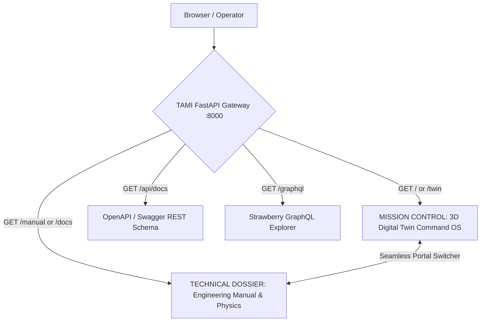

# SKHY - TAMI (Telemetry, Analytics, Monitoring, & Integration) Architecture Stack

Enterprise Instrumentation & Control (I&C) Stack and Multi-Reactor Digital Twin for **Quasi-Isodynamic (QI-HTS) Stellarators**, **Advanced Tokamaks**, and **Inertial Confinement Fusion (ICF)**, engineered by the Lead Systems Software Architecture & Staff Engineering team at SKHY.

Designed with an **Anduril-grade Obsidian Tactical C2 interface**, strict **Purdue 6-Tier Architecture isolation**, and **IEC 62443 Zero-Trust Security Conduits**.

---

## 🌐 Mission Control & Dedicated Endpoint Architecture

TAMI cleanly separates real-time operational mission control from comprehensive technical specifications and API schemas through dedicated routes and persistent top-bar navigation:



| Route | View Description | Target Audience |
| :--- | :--- | :--- |
| **`http://127.0.0.1:8000/`** or **`/twin`** | **Mission Control Command OS**: Real-time 3D Three.js reactor viewport, multi-subsystem telemetry, 2D Sankey energy balance, edge interlock simulator, and Purdue tier inspector. | Plant Operators, Control Engineers, Systems Architects |
| **`http://127.0.0.1:8000/manual`** | **Engineering Technical Dossier**: 12-chapter comprehensive physics manual, $\LaTeX$ math formulas, dark Mermaid architecture diagrams, and hardware failure modes. | Research Physicists, Nuclear Engineers, New Onboarding |
| **`http://127.0.0.1:8000/api/docs`** | **Interactive REST OpenAPI (Swagger)**: Subsystem telemetry queries, reactor mode actuation, and quench log endpoints. | Agentic AI Agents, Integration Engineers |
| **`http://127.0.0.1:8000/graphql`** | **Strawberry GraphQL Explorer**: Schema queries for coupled multi-physics time-series and power balance reports ($Q_{\text{sci}}$). | Data Science & Surrogate Model Training Teams |

---

## ⚡ Core Platform Capabilities

### 1. 3D Multi-Reactor Digital Twin Studio (Three.js WebGL)
- **Quasi-Isodynamic (QI) Stellarator**:
  - 20 modular non-planar HTS coils with out-of-plane sinusoidal twist.
  - 5-period helical plasma flux surface (V3FIT equilibrium reconstruction).
  - Island divertor target strike plates and REBCO hotspot quench detection.
- **Advanced Tokamak ($I_p = 15\text{ MA}$)**:
  - Central Solenoid induction cylinder and 16 D-shaped Toroidal Field (TF) coils.
  - Elongated D-shaped plasma core ($\kappa \approx 1.6$) with H-mode edge pedestal.
  - Upper and lower poloidal divertor target rings and major disruption collapse FX.
- **Inertial Confinement Fusion (ICF)**:
  - Spherical armored reaction chamber with cryogenic DT pellet injector.
  - 16 converging pulsed UV laser beam cones (2.15 MJ, 5 Hz repetition rate).
  - High-gain microimplosion detonations ($G = 85$) and Rayleigh-Taylor instability alerts.

### 2. 2D Interactive Sankey Energy Flow Simulator
- Inspired directly by the [Fusion Energy Base Power Plant Simulator](https://www.fusionenergybase.com/fusion-power-plant-simulator).
- Dynamic cubic Bézier power flow ribbons with animated particles.
- **Continuous Steady-State Regime** (Stellarator & Tokamak): Scientific gain ($Q_{\text{sci}}$), auxiliary heating ($P_{\text{heating}}$), thermal efficiency ($\eta_{\text{thermal}}$), driver efficiency ($\eta_{\text{driver}}$), blanket multiplier ($M$).
- **Pulsed Driver Regime** (ICF): Driver energy ($E_{\text{laser}}$ in MJ), repetition frequency ($f_{\text{rep}}$ in Hz), target gain ($G$).
- Real-time commercial net electric power calculation:
  $$P_{\text{net}} = P_{\text{gross}} - P_{\text{recirc}}$$
- Research benchmark presets: ITER Q=10 baseline, SPARC pulsed H-mode, W7-X steady-state, NIF Target Gain ($G=1.5$), Commercial QI Reactor.

### 3. Level 1 Edge Quench Protection Kernel (Rust / MTCA.4 MicroTCA)
- Zero-allocation, sub-millisecond multi-sensor fusion kernel.
- **Tri-Sensor Hardware Interlock**:
  - Fiber-Optic Acoustic Sensing (FOAS): Ultrasonic acoustic emission $> 25\text{ kHz}$.
  - Thermal Gradient ($dT/dt > 5\text{ K/s}$).
  - Dielectric Stray Capacitance Shift ($dC/dt > 15\text{ pF/s}$).
- REBCO Normal Zone Propagation Velocity (NZPV $\approx 0.01 - 0.1\text{ m/s}$) tracking.
- Ultra-low latency pyrotechnic breaker actuation ($< 50\ \mu\text{s}$) dump into liquid helium resistor banks.

### 4. Polymorphic Protocol Buffers Schema (`proto/skhy_telemetry.proto`)
- Multi-reactor confinement taxonomy: `REACTOR_QI_STELLARATOR`, `REACTOR_TOKAMAK`, `REACTOR_ICF`.
- 18 operational and failure modes covering disruptions, vertical displacement events (VDEs), ELMs, runaway electron avalanches, neoclassical tearing modes (NTMs), Rayleigh-Taylor mixing, laser power jitter, and debris shield pitting.
- Polymorphic payload union: `oneof reactor_core { StellaratorCoreTelemetry; TokamakCoreTelemetry; IcfCoreTelemetry; }`.

---

## 🏛 Architecture Overview: The 6-Tier Purdue Model & IEC 62443 Conduits

```
  +-----------------------------------------------------------------------------------+
  | LEVEL 5: ENTERPRISE AGENTIC AI & MULTI-PHYSICS TRAINING                          |
  | - REST & GraphQL API (FastAPI / Strawberry)                                      |
  | - Multi-Reactor Dynamic Queries & PINN Surrogate Datasets                        |
  +-----------------------------------------------------------------------------------+
                                        ▲  ▲
                                        │  │ (Conduit: REST/GraphQL HTTP/2)
                                        ▼  ▼
  +-----------------------------------------------------------------------------------+
  | LEVEL 4: DIGITAL TWIN SURROGATE ENGINE & DATA LAKE PERSISTENCE                   |
  | - PyTorch Multi-Physics Surrogate Models (Stellarator, Tokamak, ICF)             |
  | - Three.js WebGL 3D Interactive Viewport & 2D Sankey Energy Canvas               |
  | - HDF5 Time-Series Archival (`tami_data_lake.h5` / IMAS Standard Data Structure)  |
  +-----------------------------------------------------------------------------------+
                                        ▲  ▲
                                        │  │ (Conduit: Apache Kafka / TLS 1.3 Streaming)
                                        ▼  ▼
  +-----------------------------------------------------------------------------------+
  | LEVEL 3: TAMI SUPERVISORY CONTROL MIDDLEWARE HUB (Rust)                           |
  | - High-Throughput Protobuf Ingestion & Rate-Limiting                              |
  | - Envelope Token Validation & Sequence Continuity Check                           |
  | - High-Priority Microsecond Alert Broadcast Bus                                  |
  +-----------------------------------------------------------------------------------+
                                        ▲  ▲
                                        │  │ (Conduit: DDS Real-Time Control Bus)
                                        ▼  ▼
  +-----------------------------------------------------------------------------------+
  | LEVEL 2: AREA CONTROL & PLCs                                                      |
  | - Deterministic Magnet Power Supply Subsystem Controllers                        |
  | - Cryogenic Flow Regulators & Laser Bank Timing Systems                           |
  +-----------------------------------------------------------------------------------+
                                        ▲  ▲
                                        │  │ (Conduit: Direct Sub-Millisecond Bus)
                                        ▼  ▼
  +-----------------------------------------------------------------------------------+
  | LEVEL 1: EDGE QUENCH PROTECTION MODULE (Rust / MTCA.4 MicroTCA FPGA)             |
  | - Zero-Allocation Microsecond Protection Kernel                                   |
  | - Multi-Sensor Fusion: FOAS (>25 kHz acoustic burst) + dT/dt (>5 K/s) + dC/dt     |
  | - REBCO Normal Zone Propagation Velocity (NZPV ~0.01 - 0.1 m/s) Tracking          |
  | - Immediate Hardware Fast Discharge Breaker Actuation (<50 μs)                    |
  +-----------------------------------------------------------------------------------+
                                        ▲  ▲
                                        │  │ (Level 0 Hardware Sensors & Actuators)
  +-----------------------------------------------------------------------------------+
  | LEVEL 0: PHYSICAL REACTOR HARDWARE & SENSORS                                      |
  | - Fiber-Optic Acoustic Sensing (FOAS) Strain Cables & REBCO Tape Coils            |
  | - Central Solenoid, TF D-Coils, Divertor Langmuir Probes, UV Laser Amplifiers     |
  +-----------------------------------------------------------------------------------+
```

---

## 🔒 Security Architecture (IEC 62443 Compliance)

1. **Zone Segregation**: Level 0/1 (Safety Interlock Zone), Level 2 (Area Control Zone), Level 3 (Supervisory Zone), and Level 4/5 (Enterprise/AI Zone) are isolated into distinct security subnets.
2. **Conduits**:
   - **L0/L1 -> L2/L3**: Microsecond deterministic DDS channels and direct UDP fast dump interlock conduit.
   - **L3 -> L4**: Apache Kafka secure streaming conduit with TLS 1.3 encryption.
   - **L4 -> L5**: Read-only REST and GraphQL endpoints for AI training and agent query without back-propagation permissions into control loops.
3. **Zero-Trust Envelope**: Every message carries a `skhy.telemetry.Envelope` header with nanosecond timestamps, source node verification, sequence counters, and HMAC security tokens.

---

## 📁 Repository Structure

```
c:\Projects\tami-cama\
├── proto/
│   ├── skhy_telemetry.proto             # Multi-reactor Protobuf schema (Stellarator, Tokamak, ICF)
│   └── skhy_telemetry_pb2.py            # Compiled Python Protobuf classes
├── middleware_hub/                       # Purdue Level 3 Middleware Hub (Rust)
│   ├── Cargo.toml
│   ├── build.rs                          # Auto-compiles Protobuf with prost-build & vendored protoc
│   └── src/main.rs                       # Ingestion, rate-limiting, sequence check, and DDS/Kafka bridge
├── edge_quench/                          # Purdue Level 1 Edge Protection Kernel (Rust)
│   ├── Cargo.toml
│   ├── build.rs
│   └── src/main.rs                       # Sub-millisecond multi-sensor fusion (FOAS, dT/dt, NZPV) & microsecond fast dump
├── python_common/                        # Generated Python Protobuf package
│   ├── __init__.py
│   └── skhy_telemetry_pb2.py
├── synthetic_generator/                  # Purdue Level 0/1 Synthetic Sensor Generator (Python)
│   └── synthetic_data_gen.py             # Multi-reactor continuous telemetry stream with 18 failure modes
├── digital_twin/                         # Purdue Level 4/5 Surrogate Engine (Python / PyTorch)
│   └── digital_twin_engine.py            # PINN surrogate reconstructing 3D flux mesh, Tokamak & ICF physics
├── tutorial_viewer/                     # Obsidian C2 Web Interface
│   ├── index.html                        # Mission Control OS: 3D Reactor Twin & Subsystem HUD
│   ├── manual.html                       # Engineering Technical Dossier: 12-Chapter Physics Manual
│   ├── style.css                         # Obsidian Tactical dark theme design system
│   └── app.js                            # Three.js 3D procedural models & FEB-inspired Sankey flow engine
├── run_demo.py                           # Master end-to-end orchestrator & benchmark script
├── run_tutorial.py                       # Standalone launcher for Engineering Technical Dossier
├── TUTORIAL.md                           # Master markdown source for fusion physics & architecture
└── .gitignore                            # Clean ignores for Rust/Python/HDF5 build artifacts
```

---

## 🚀 Quick Start & Live Demonstration

### 1. Launch Complete End-to-End Mission Control (All 6 Levels)

To launch the full enterprise stack (Level 1 Edge Node, Level 3 Middleware Hub, Level 4 Digital Twin, Level 5 Data Lake API, and Synthetic Multi-Reactor Telemetry Stream):

```bash
python run_demo.py
```

This starts all subsystems, performs REST/GraphQL verification tests, and automatically opens **Mission Control** in your default browser at:
`http://127.0.0.1:8000/`

### 2. Launch Engineering Technical Manual & Dossier

To start the server and directly open the 12-chapter technical guide:

```bash
python run_tutorial.py
```

Or navigate to `http://127.0.0.1:8000/manual`.

---

## 🛠 Running Components Individually

You can also run any Purdue tier independently:

### Level 1 Edge Protection Module (Rust)
```bash
cd edge_quench
cargo run --release
```

### Level 3 Supervisory Middleware Hub (Rust)
```bash
cd middleware_hub
cargo run --release
```

### Level 4/5 Data Lake API & C2 Server (Python / FastAPI)
```bash
python data_lake_api/ai_ingestion_api.py
```
- **Mission Control**: `http://127.0.0.1:8000/`
- **Technical Manual**: `http://127.0.0.1:8000/manual`
- **REST API Docs**: `http://127.0.0.1:8000/api/docs`
- **GraphQL Console**: `http://127.0.0.1:8000/graphql`
- **Active Topologies**: `http://127.0.0.1:8000/api/v1/reactors`

### Level 4/5 Digital Twin PINN Engine (PyTorch)
```bash
python digital_twin/digital_twin_engine.py
```

### Level 0/1 Synthetic Telemetry Generator (Continuous Stream)
```bash
# Run for QI Stellarator (default nominal steady-state)
python synthetic_generator/synthetic_data_gen.py --freq 25.0 --reactor REACTOR_QI_STELLARATOR

# Inject HTS Magnet Quench Anomaly
python synthetic_generator/synthetic_data_gen.py --reactor REACTOR_QI_STELLARATOR --mode MODE_HTS_COIL_HOTSPOT_QUENCH

# Run Advanced Tokamak with Major Disruption
python synthetic_generator/synthetic_data_gen.py --reactor REACTOR_TOKAMAK --mode MODE_TOKAMAK_MAJOR_DISRUPTION

# Run ICF with Rayleigh-Taylor Implosion Asymmetry
python synthetic_generator/synthetic_data_gen.py --reactor REACTOR_ICF --mode MODE_ICF_RAYLEIGH_TAYLOR_ASYMMETRY
```

---

## 🔬 Physics & Engineering References

- **Scientific Gain ($Q_{\text{sci}}$) & Plant Balance**: Modeled after published data and the [Fusion Energy Base Power Plant Simulator](https://www.fusionenergybase.com/fusion-power-plant-simulator).
- **HTS REBCO Quench Dynamics**: Normal Zone Propagation Velocity ($NZPV \approx 0.01 - 0.1\text{ m/s}$) and Fiber-Optic Acoustic Sensing (FOAS) based on experimental magnet data.
- **Tokamak Disruption Physics**: $I_p$ thermal/current quench and locked-mode precursors calibrated to ITER/SPARC parameters.
- **Purdue Model & ICS Security**: Standardized under ISA-95 and IEC 62443 zero-trust zone-conduit architecture.
