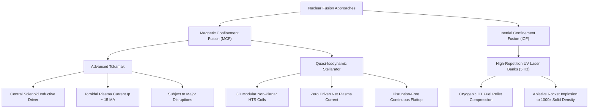
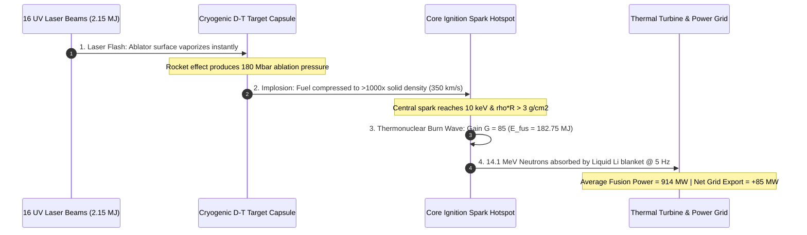
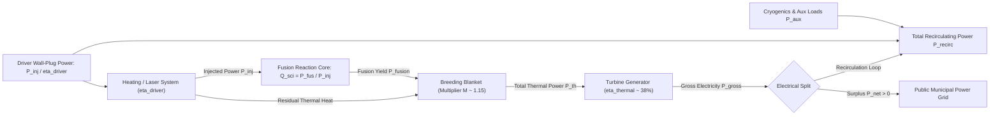
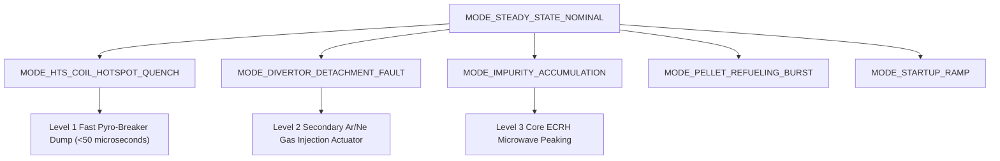
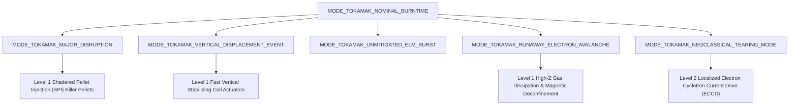
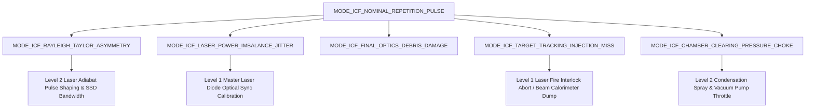
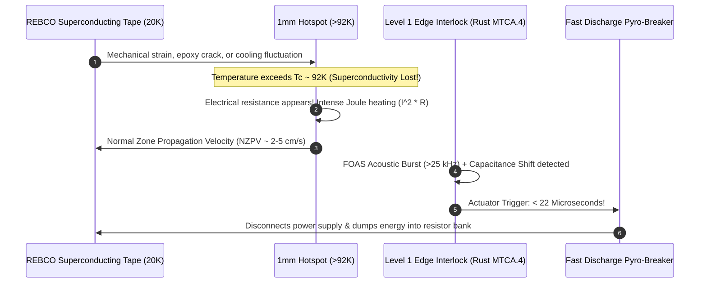
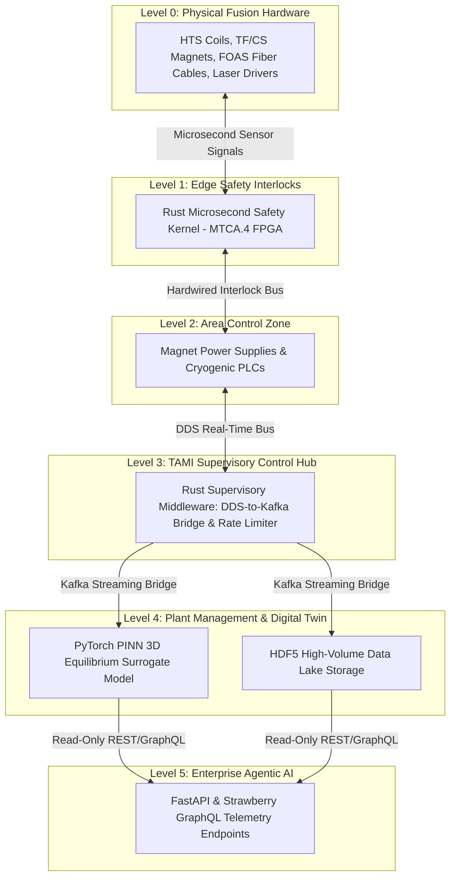
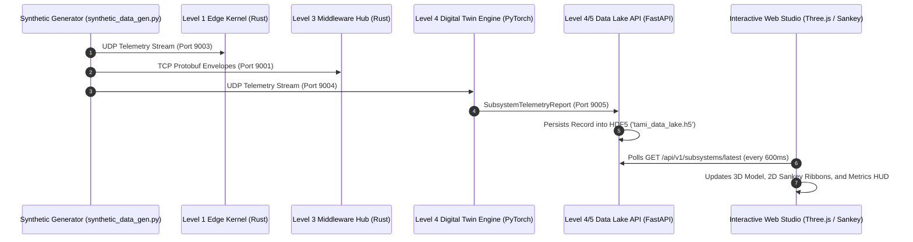

# Beginner's Guide: Nuclear Fusion, Multi-Reactor Topologies, and TAMI Control Architecture

Welcome! If you are new to nuclear fusion, magnetics, laser drivers, or real-time control software, this tutorial is designed for you. You do not need an advanced degree in plasma physics or decades of industrial automation experience to understand how this code works.

This guide breaks down every concept step-by-step using clear physical analogies, rigorous mathematical formulas rendered via $\LaTeX$, interactive Mermaid architecture diagrams, and real-world citations from [Fusion Energy Base](https://www.fusionenergybase.com/articles?tag=physics).

---

## 📚 Table of Contents

1. [What is Nuclear Fusion?](#1-what-is-nuclear-fusion)
2. [Fusion Reactor Architectures: Stellarators, Tokamaks, and ICF](#2-fusion-reactor-architectures-stellarators-tokamaks-and-icf)
   - 2.1 [The Three Major Confinement Topologies](#21-the-three-major-confinement-topologies)
   - 2.2 [Tokamak Electromagnetics & Operational Limits](#22-tokamak-electromagnetics--operational-limits)
   - 2.3 [Quasi-Isodynamic (QI) Modular Stellarators](#23-quasi-isodynamic-qi-modular-stellarators)
   - 2.4 [Laser Inertial Confinement Fusion (ICF)](#24-laser-inertial-confinement-fusion-icf)
   - 2.5 [The Lawson Criteria: Magnetic Confinement vs. Areal Density](#25-the-lawson-criteria-magnetic-confinement-vs-areal-density)
   - 2.6 [Plant Power Balance & 2D Sankey Energy Flow](#26-plant-power-balance--2d-sankey-energy-flow)
   - 2.7 [Landmark Fusion Experiments & Published Gain Presets](#27-landmark-fusion-experiments--published-gain-presets)
3. [Exhaustive Fusion & I&C Terminology Glossary](#3-exhaustive-fusion--ic-terminology-glossary)
4. [Cross-Reactor Failure Modes: Comprehensive Physics Deep-Dive](#4-cross-reactor-failure-modes-comprehensive-physics-deep-dive)
   - 4.1 [Stellarator Failure Modes (QI-HTS)](#41-stellarator-failure-modes-qi-hts)
   - 4.2 [Tokamak Failure Modes (Inductive & Steady-State)](#42-tokamak-failure-modes-inductive--steady-state)
   - 4.3 [Inertial Confinement Failure Modes (Pulsed Laser ICF)](#43-inertial-confinement-failure-modes-pulsed-laser-icf)
5. [High-Temperature Superconductors (HTS) & REBCO Magnet Coils](#5-high-temperature-superconductors-hts--rebco-magnet-coils)
6. [The Critical Failure: What is a Magnet Quench?](#6-the-critical-failure-what-is-a-magnet-quench)
7. [How We Detect Quenches: FOAS & Stray Capacitance](#7-how-we-detect-quenches-foas--stray-capacitance)
8. [The Software Architecture: Purdue 6-Tier Model & IEC 62443 Security](#8-the-software-architecture-purdue-6-tier-model--iec-62443-security)
9. [Digital Twins, Three.js 3D Rendering & Physics-Informed Neural Networks (PINN)](#9-digital-twins-threejs-3d-rendering--physics-informed-neural-networks-pinn)
10. [Codebase Execution Flow: Step-by-Step Telemetry Journey](#10-codebase-execution-flow-step-by-step-telemetry-journey)
11. [External References & Scientific Citations](#11-external-references--scientific-citations)

---

## 1. What is Nuclear Fusion?

At its core, **nuclear fusion** is the power source of the Sun and stars.

As explained on [Fusion Energy Base - What is Fusion Energy?](https://www.fusionenergybase.com/articles/what-is-fusion-energy):
> *"When two light atomic nuclei like Deuterium and Tritium (two isotopes of hydrogen) fuse into a heavier element like Helium and a free neutron, energy is released. The energy comes from converting a small fraction of the mass of the reactants into kinetic energy via Einstein's mass-energy equivalence $E = \Delta m \cdot c^2$."*

```
   Deuterium (²H)  \
                     ===>  [ FUSION REACTION ] ===>  Helium-4 (⁴He, 3.52 MeV) + Free Neutron (n, 14.06 MeV)
   Tritium (³H)    /
```

### Why is Controlled Fusion Challenging?
1. **Coulomb Repulsion**: Both hydrogen nuclei carry a positive electric charge. Like charges violently repel each other.
2. **Extreme Thermal Energies**: To overcome this electrostatic barrier and bring nuclei close enough for the Strong Nuclear Force to bind them ($\sim 10^{-15}\text{ m}$), the fuel must be heated to over **$100\text{--}150\text{ Million }^\circ\text{C}$** ($10\text{--}15\text{ keV}$).
3. **Plasma State**: At these temperatures, matter exists as an electrically conductive ionized fluid of stripped electrons and ions called **Plasma**.

---

## 2. Fusion Reactor Architectures: Stellarators, Tokamaks, and ICF

No physical solid material can directly contact a $150\text{ Million }^\circ\text{C}$ plasma without vaporizing immediately. The global fusion effort has developed three primary physical approaches:



---

### 2.1 The Three Major Confinement Topologies

| Engineering Metric | Advanced Tokamak | QI Modular Stellarator | Laser Inertial Confinement (ICF) |
| :--- | :--- | :--- | :--- |
| **Confinement Mechanism** | Magnetic (Toroidal + Poloidal Fields) | Magnetic (3D Omnigenous Coils) | Inertial (Ablation Drive Pressure) |
| **Operational Duty Cycle** | Pulsed / Inductive ($\sim 10^3\text{ s}$) | Continuous Steady-State ($10^6\text{ s}$) | High-Repetition Pulsed ($5\text{--}10\text{ Hz}$) |
| **Plasma Current ($I_p$)** | High ($15\text{--}20\text{ MA}$) | Zero ($I_{\text{net}} \approx 0\text{ kA}$) | Zero (Target microcapsule) |
| **Major Disruption Risk** | **High** (Current collapse $<15\text{ ms}$) | **Zero** (Inherently stable) | None (Hydrodynamic instabilities instead) |
| **Primary Driver System** | Central Solenoid + NBI + RF ($65\%$) | ECRH Gyrotrons + ICRH ($60\%$) | Diode-Pumped UV Solid-State Lasers ($15\%$) |
| **Scientific Gain ($Q_{\text{sci}}$ / $G$)** | $Q_{\text{sci}} \approx 10\text{--}15$ | $Q_{\text{sci}} \approx 10\text{--}12$ | Target Gain $G \approx 80\text{--}120$ |
| **Exhaust / First Wall** | Single/Double Null Poloidal Divertor | Helical Island Divertor | Spherical Chamber w/ Liquid Li Waterfall |

---

### 2.2 Tokamak Electromagnetics & Operational Limits

An **Advanced Tokamak** achieves magnetic twist by driving a massive toroidal electric current $I_p$ directly through the plasma using an inductive transformer called the **Central Solenoid**.

#### Fundamental Physics Equations:
1. **Safety Factor ($q_{95}$)**:
   Measures the helical pitch of magnetic field lines at the 95% normalized flux surface. To avoid violent kink instabilities, the safety factor must satisfy the Kruskal-Shafranov limit:
   $$q_{95} \approx \frac{5 a^2 B_T}{R_0 I_p} \left( \frac{1 + \kappa^2}{2} \right) \ge 2.5\text{--}3.0$$
   Where $a$ is minor radius, $R_0$ is major radius, $B_T$ is toroidal field, and $\kappa$ is vertical plasma elongation ($\sim 1.7$).

2. **Greenwald Density Limit ($n_G$)**:
   The maximum line-averaged electron density before radiative edge cooling triggers a total plasma disruption:
   $$n_G = \frac{I_p}{\pi a^2} \times 10^{20} \text{ m}^{-3}$$
   Operating at $n_e / n_G > 0.85$ requires aggressive fueling and edge-localized mode (ELM) mitigation.

3. **Loop Voltage & Inductive Flux**:
   $$V_{\text{loop}} = \frac{d\Phi_{\text{CS}}}{dt} = L_p \frac{dI_p}{dt} + R_p I_p$$
   During nominal flattop, $V_{\text{loop}} \approx 0.1\text{ V}$. During a **Major Disruption**, the sudden current collapse ($\frac{dI_p}{dt} \approx -10^9\text{ A/s}$) induces a destructive voltage spike:
   $$V_{\text{loop,disrupt}} > 150\text{--}200\text{ Volts}$$

---

### 2.3 Quasi-Isodynamic (QI) Modular Stellarators

In a **Quasi-Isodynamic Stellarator** (championed by **SKHY**), the entire helical twisting field is generated completely by external **3D non-planar superconducting modular coils**, requiring **zero net plasma current** ($I_p = 0$).

#### Key Physical Advantages:
1. **Intrinsic Disruption Immunity**: Since there is no multi-megampere plasma current, current-driven disruptions, vertical displacement events (VDEs), and locked modes are physically impossible.
2. **Omnigenity & Reduced Neoclassical Ripple**:
   In classic stellarators, 3D field ripples caused trapped particles to drift outward. Quasi-isodynamic optimization guarantees that the bounce-averaged radial drift velocity vanishes:
   $$\overline{v_{dr}} = \frac{1}{\tau_b} \oint \frac{v_\parallel \times \nabla B}{\Omega} \cdot \nabla \psi \, dt = 0$$
   This reduces neoclassical heat transport to levels comparable to axisymmetric tokamaks.
3. **Resonant Island Divertor**:
   The magnetic field naturally forms closed magnetic islands at rational rotational transform boundaries ($\iota = n/m = 5/5$). Heat and helium ash flow gently into target plates along these island legs, achieving radiative detachment at heat fluxes $\le 5\text{ MW/m}^2$.

---

### 2.4 Laser Inertial Confinement Fusion (ICF)

Instead of holding plasma magnetically for seconds, **Inertial Confinement Fusion** compresses a frozen Deuterium-Tritium pellet ($r \approx 1\text{ mm}$) to immense densities using high-energy laser pulses.



#### Key Physics Quantities:
1. **Target Gain ($G$)**:
   $$G = \frac{E_{\text{fusion}}}{E_{\text{driver}}} = \frac{182.75\text{ MJ}}{2.15\text{ MJ}} \approx 85.0$$
2. **Implosion Velocity & Stagnation Pressure**:
   The ablator rocket velocity exceeds $v_{\text{imp}} \approx 350\text{--}400\text{ km/s}$, driving ablation pressures $P_{\text{abl}} \approx 100\text{--}250\text{ Mbar}$.
3. **Repetition Rate ($f_{\text{rep}}$) & Average Power**:
   To generate steady commercial power, targets are injected and zapped at $f_{\text{rep}} \approx 5.0\text{ Hz}$:
   $$P_{\text{fusion,avg}} = E_{\text{laser}} \cdot G \cdot f_{\text{rep}} = 2.15\text{ MJ} \cdot 85 \cdot 5\text{ s}^{-1} \approx 913.75\text{ MW}$$

---

### 2.5 The Lawson Criteria: Magnetic Confinement vs. Areal Density

To achieve net energy release, the fusion reaction must generate enough alpha particle self-heating ($E_\alpha = 3.52\text{ MeV}$) to overcome Bremsstrahlung radiation and thermal conduction losses.

#### 1. Magnetic Confinement (Lawson Triple Product):
$$n \cdot T \cdot \tau_E \ge 3 \times 10^{21} \text{ keV}\cdot\text{s}\cdot\text{m}^{-3}$$
- High Confinement Time ($\tau_E \approx 1.5\text{--}3.0\text{ s}$)
- Moderate Density ($n_e \approx 1\text{--}3 \times 10^{20}\text{ m}^{-3}$)
- Core Temperature ($T_i \approx 10\text{--}20\text{ keV}$)

#### 2. Inertial Confinement (Areal Density $\rho R$):
$$\rho R \ge 3.0 \text{ g/cm}^2$$
- Ultra-Short Confinement Time ($\tau_{\text{inertial}} \approx \frac{R}{c_s} \approx 0.1\text{ ns}$)
- Ultra-High Density ($\rho \approx 300\text{--}1000\text{ g/cm}^3$, or $10^{26}\text{ m}^{-3}$)

---

### 2.6 Plant Power Balance & 2D Sankey Energy Flow

As demonstrated in the interactive **2D Sankey Simulator** (inspired directly by the [Fusion Energy Base Simulator](https://www.fusionenergybase.com/fusion-power-plant-simulator)), a commercial power plant must balance electrical inputs against thermal and electric conversion efficiencies.



#### Core Mathematical Equations:
1. **Scientific Gain ($Q_{\text{sci}}$) vs. Target Gain ($G$)**:
   $$Q_{\text{sci}} = \frac{P_{\text{fusion}}}{P_{\text{injected}}} \quad\text{or}\quad G = \frac{E_{\text{fusion}}}{E_{\text{laser}}}$$
2. **Total Thermal Power into Steam Cycle**:
   $$P_{\text{thermal}} = P_{\text{fusion}} \cdot M + P_{\text{injected}}$$
   Where $M \approx 1.15$ is the blanket energy multiplier from exothermic Lithium-6 neutron capture:
   $$\text{n} + {}^6\text{Li} \to {}^4\text{He} + {}^3\text{H} + 4.78\text{ MeV}$$
3. **Gross Electricity Generated**:
   $$P_{\text{gross}} = P_{\text{thermal}} \cdot \eta_{\text{thermal}}$$
4. **Total Recirculating Electrical Power**:
   $$P_{\text{recirc}} = \frac{P_{\text{injected}}}{\eta_{\text{driver}}} + P_{\text{aux}}$$
5. **Net Electric Power to Grid**:
   $$P_{\text{net}} = P_{\text{gross}} - P_{\text{recirc}}$$
6. **Engineering Gain ($Q_{\text{eng}}$)**:
   $$Q_{\text{eng}} = \frac{P_{\text{gross}}}{P_{\text{recirc}}}$$

> [!IMPORTANT]
> **Why $Q_{\text{sci}} = 1.0$ is insufficient for electricity generation**:
> For a laser-driven ICF system with $\eta_{\text{driver}} = 15\%$ and $\eta_{\text{th}} = 38\%$, the engineering breakeven ($P_{\text{net}} > 0$) requires:
> $$G > \frac{1}{\eta_{\text{driver}} \cdot \eta_{\text{thermal}}} \approx \frac{1}{0.15 \cdot 0.38} \approx 17.5$$
> For commercial economics ($Q_{\text{eng}} \ge 2.5$), the target gain must exceed **$G \ge 80\text{--}100$**!

---

### 2.7 Landmark Fusion Experiments & Published Gain Presets

Different fusion concepts and historical machines have achieved widely varying scientific gains ($Q_{\text{sci}}$) and target gains ($G$). The 2D Energy Diagram allows you to load published presets directly from peer-reviewed literature:

| Preset Name | Concept | Citation / Reference | Input Power / Energy | Fusion Yield | Gain Metric | Net Grid Power ($P_{\text{net}}$) |
| :--- | :--- | :--- | :--- | :--- | :--- | :--- |
| **JET D-T Record (1997)** | Tokamak | Keilhacker et al., *Nuclear Fusion* 39, 209 (1999) | $P_{\text{heat}} = 24.0\text{ MW}$ | $P_{\text{fus}} = 16.1\text{ MW}$ | $Q_{\text{sci}} = 0.67$ | **$-32.5\text{ MW}$** (Net Consumer) |
| **ITER Baseline Target** | Tokamak | ITER Physics Basis, *Nuclear Fusion* 39, 2137 (1999) | $P_{\text{aux}} = 50.0\text{ MW}$ | $P_{\text{fus}} = 500.0\text{ MW}$ | $Q_{\text{sci}} = 10.0$ | **$+125.0\text{ MW}$** (Design Benchmark) |
| **SPARC CFS Baseline** | Compact HTS Tokamak | Creely et al., *J. Plasma Phys.* 86, 865860502 (2020) | $P_{\text{in}} = 12.5\text{ MW}$ | $P_{\text{fus}} = 140.0\text{ MW}$ | $Q_{\text{sci}} = 11.2$ | **$+38.5\text{ MW}$** (High-Field Net) |
| **NIF Target Ignition (2022/23)** | Laser ICF | Abu-Shawareb et al., *Phys. Rev. Lett.* 132, 065102 (2024) | $E_{\text{laser}} = 2.05\text{ MJ}$ | $E_{\text{fus}} = 3.88\text{ MJ}$ | $G = 1.89$ | **$-12.2\text{ MW}$** (Lab Ignition Only) |
| **IFE Commercial Plant Target** | Laser ICF | Meier et al., *Laser & Particle Beams* 32, 281 (2014) | $E_{\text{laser}} = 2.15\text{ MJ}$ ($5\text{ Hz}$) | $E_{\text{fus}} = 182.8\text{ MJ}$ | $G = 85.0$ | **$+263.5\text{ MW}$** (Commercial Surplus) |
| **W7-X Record Triple Product** | QI Stellarator | Wolf et al., *Physics of Plasmas* 26, 082504 (2019) | $P_{\text{ECRH}} = 7.0\text{ MW}$ | Pure Deuterium Test | $n\tau T = 6.5\times 10^{19}$ | Laboratory Milestone (Non-D-T) |
| **SKHY Commercial Stellarator** | QI Modular HTS | SKHY Engineering Baseline Spec (2026) | $P_{\text{heat}} = 25.0\text{ MW}$ | $P_{\text{fus}} = 262.5\text{ MW}$ | $Q_{\text{sci}} = 10.5$ | **$+58.2\text{ MW}$** (Steady-State Export) |

---

## 3. Exhaustive Fusion & I&C Terminology Glossary

To help engineers and researchers navigate the codebase, here are rigorous explanations of every core term:

### 1. Scientific Gain ($Q_{\text{sci}}$)
The ratio of nuclear fusion power produced by the plasma to the external heating power injected into the plasma:
$$Q_{\text{sci}} = \frac{P_{\text{fusion}}}{P_{\text{injected}}}$$
- $Q < 1.0$: Sub-breakeven regime.
- $Q = 1.0$: **Scientific Breakeven** (fusion power equals external heating power).
- $Q = 5.0$: **Alpha Heating Dominated** (self-heating from $3.52\text{ MeV}$ helium nuclei equals external heating).
- $Q = \infty$: **Thermonuclear Ignition** (the reaction is completely self-sustaining without external heating).

### 2. Engineering Gain ($Q_{\text{eng}}$)
The ratio of gross electrical energy produced by the plant turbines to the total electrical energy recirculated to run the reactor:
$$Q_{\text{eng}} = \frac{P_{\text{gross,electric}}}{P_{\text{recirculating,electric}}}$$
For a commercial plant to sell electricity economically to the grid, it requires $Q_{\text{eng}} \ge 2.5\text{--}4.0$.

### 3. Target Gain ($G$ in ICF)
In laser-driven inertial confinement, target gain is defined as the fusion energy yield per shot divided by the laser pulse energy incident on the target capsule:
$$G = \frac{E_{\text{fusion}}}{E_{\text{laser}}}$$

### 4. Lawson Triple Product ($n \cdot T \cdot \tau_E$)
The product of plasma density $n$, ion temperature $T$, and energy confinement time $\tau_E$. It represents the fundamental criterion for net power balance. For D-T fusion, ignition requires $n \cdot T \cdot \tau_E \ge 3 \times 10^{21}\text{ keV}\cdot\text{s}\cdot\text{m}^{-3}$.

### 5. Energy Confinement Time ($\tau_E$)
The characteristic timescale over which thermal energy leaks out of the magnetic confinement volume:
$$\tau_E = \frac{W_{\text{thermal}}}{P_{\text{loss}}}$$
Where $W_{\text{thermal}} = \frac{3}{2} \int (n_e T_e + n_i T_i) \, dV$. In commercial reactors, $\tau_E \sim 1.5\text{--}3.0\text{ seconds}$.

### 6. Kruskal-Shafranov Safety Factor ($q_{95}$)
The number of toroidal turns a magnetic field line makes per single poloidal turn at the 95% flux surface. In tokamaks, operating at $q_{95} < 2.0$ causes violent $m=1, 2$ external kink instabilities that terminate the discharge.

### 7. Greenwald Density Limit ($n_G$)
An empirical upper boundary on electron density in tokamaks:
$$n_G = \frac{I_p}{\pi a^2} \times 10^{20}\text{ m}^{-3}$$
Exceeding $n_G$ triggers edge radiation instability and disruptive termination.

### 8. Toroidal Beta ($\beta$) and Normalized Beta ($\beta_N$)
The ratio of plasma thermal pressure to magnetic field pressure:
$$\beta = \frac{\langle p \rangle}{B^2 / 2\mu_0}$$
The Troyon limit defines the maximum stable beta in tokamaks: $\beta_N = \beta \frac{a B_T}{I_p} \le 2.8\text{--}3.5$.

### 9. Neoclassical Tearing Modes (NTM)
Resistive MHD instabilities in tokamaks where helical magnetic islands grow at rational surfaces ($q = 2/1$ or $q = 3/2$), flattening temperature profiles and degrading energy confinement by up to 50%.

### 10. Edge-Localized Modes (ELMs)
Periodic explosive relaxation instabilities at the steep transport barrier (pedestal) of H-mode plasmas, expelling gigawatt-level heat bursts onto divertor plates.

### 11. Vertical Displacement Event (VDE)
In elongated tokamaks ($\kappa > 1.5$), the plasma is vertically unstable. If active feedback coils saturate, the entire plasma column drifts vertically into the vacuum vessel wall within milliseconds, generating massive destructive **halo currents**.

### 12. Runaway Electrons & Dreicer Field
During a rapid thermal quench in tokamaks, the inductive loop voltage surges. If the electric field exceeds the Dreicer critical limit ($E_D$), collisional friction drops, accelerating electrons to relativistic velocities ($\sim 50\text{ MeV}$) forming a concentrated beam that can pierce the stainless steel vacuum vessel.

### 13. Normal Zone Propagation Velocity (NZPV)
The speed at which a resistive hotspot propagates along a superconducting tape:
- Low-Temperature Superconductors (NbTi): $\text{NZPV} \sim 10\text{--}30\text{ m/s}$ (heats quickly and spreads safely).
- High-Temperature Superconductors (REBCO): $\text{NZPV} \sim 0.01\text{--}0.08\text{ m/s}$ (stagnant, concentrating heat in a $1\text{ mm}$ hotspot).

### 14. Fiber-Optic Acoustic Sensing (FOAS)
Ultrasonic diagnostic technique using co-wound optical fiber to detect high-frequency acoustic emissions ($25\text{--}40\text{ kHz}$) emitted when crystalline REBCO layers experience micro-delamination and Lorentz strain relaxation prior to thermal quench.

### 15. Dual-Coolant Lead-Lithium (DCLL) Blanket
A breeding blanket concept using liquid eutectic Lead-Lithium ($\text{Pb}_{84}\text{Li}_{16}$) circulating at $450\text{--}550^\circ\text{C}$ to both breed tritium via neutron capture on ${}^6\text{Li}$ and transfer heat to power turbines.

### 16. Tritium Breeding Ratio (TBR)
The number of tritium atoms bred in the blanket per tritium atom consumed in the core:
$$\text{TBR} = \frac{\text{Tritium Bred}}{\text{Tritium Burned}}$$
Self-sufficiency requires $\text{TBR} \ge 1.05\text{--}1.15$ to account for radioactive decay ($t_{1/2} = 12.3\text{ years}$) and processing losses.

### 17. Rayleigh-Taylor (RT) Instability in ICF
A fluid instability occurring when a low-density ablating plasma accelerates a high-density fuel shell. Small initial perturbations grow exponentially ($\gamma = \sqrt{k g}$), puncturing the shell and cooling the central spark hotspot.

---

## 4. Cross-Reactor Failure Modes: Comprehensive Physics Deep-Dive

The TAMI control stack monitors and mitigates 18 distinct failure modes across the three reactor topologies:

### 4.1 Stellarator Failure Modes (QI-HTS)



#### 1. `MODE_HTS_COIL_HOTSPOT_QUENCH` (Critical)
- **Physics Root Cause**: Localized cryogenic helium cooling void or epoxy debonding in a 3D non-planar REBCO coil. Local temperature exceeds $T_c \approx 92\text{ K}$, causing local electrical resistance and $I^2 R$ Joule heating.
- **Sensor Signature**: FOAS acoustic emission spike $> 25\text{ kHz}$, co-wound stray capacitance rate $dC/dt > 15\text{ pF/s}$, $dT/dt > 5.0\text{ K/s}$.
- **Edge Action**: Level 1 FPGA triggers pyrotechnic breaker within $< 22\,\mu\text{s}$, dumping 14 gigajoules of magnetic energy into external resistive dump banks.

#### 2. `MODE_DIVERTOR_DETACHMENT_FAULT` (Anomaly)
- **Physics Root Cause**: Argon/Neon radiative impurity gas puffing valve clogs. The scrape-off layer (SOL) plasma re-attaches directly to tungsten island divertor target plates.
- **Sensor Signature**: Divertor target heat flux surges past the engineering threshold ($10\text{ MW/m}^2$) to $> 16.8\text{ MW/m}^2$; tile thermocouples exceed $920^\circ\text{C}$.
- **Edge Action**: Level 2 PLC opens secondary reserve gas puff conduits and throttles auxiliary ECRH heating power by 25%.

#### 3. `MODE_IMPURITY_ACCUMULATION` (Anomaly)
- **Physics Root Cause**: High-Z tungsten atoms sputtered from divertor plates migrate into the core. High radiative Bremsstrahlung cooling ($P_{\text{rad}} \propto Z^2$) cools the core center.
- **Sensor Signature**: Soft X-ray core emissivity surges, core electron temperature drops from $14.5\text{ keV}$ to $< 6.2\text{ keV}$, scientific gain degrades to $Q_{\text{sci}} \approx 2.4$.
- **Edge Action**: Level 3 supervisory hub repositions central ECRH microwave mirrors to heat the center and drive outward neoclassical impurity flushing.

#### 4. `MODE_PELLET_REFUELING_BURST` (Nominal Transient)
- **Physics Root Cause**: Cryogenic frozen Deuterium-Tritium pellet injected at $1200\text{ m/s}$ vaporizes in core plasma.
- **Sensor Signature**: Instantaneous density spike ($n_e > 2.8 \times 10^{20}\text{ m}^{-3}$), temporary drop in core temperature followed by a $35\%$ surge in alpha heating.
- **Edge Action**: Fast feedforward control on fueling injectors to maintain stable pressure profile.

#### 5. `MODE_STARTUP_RAMP` (Nominal Transient)
- **Physics Root Cause**: Energizing 20 modular coils from 0 to 5.5 Tesla, establishing 20 Kelvin cryogenics, and initial ECRH microwave breakdown.
- **Sensor Signature**: Coil mechanical stress ramps from 0 to $145\text{ MPa}$; microwave absorbed power reaches $15\text{ MW}$.
- **Edge Action**: Coordinated power supply ramping adhering to strict magnet stress limits.

---

### 4.2 Tokamak Failure Modes (Inductive & Steady-State)



#### 1. `MODE_TOKAMAK_MAJOR_DISRUPTION` (Critical)
- **Physics Root Cause**: MHD instability (e.g., $m=2, n=1$ locked mode) triggers a sudden **Thermal Quench** ($< 1\text{ ms}$), dumping all thermal energy onto the walls. The freezing plasma's electrical resistance spikes, causing a catastrophic **Current Quench** ($dI_p/dt \approx -10^9\text{ A/s}$).
- **Sensor Signature**: Magnetic pick-up coils ($dB/dt$), loop voltage spike $V_{\text{loop}} > 185\text{ Volts}$, massive hard X-ray bursts.
- **Edge Action**: Level 1 interlock fires **Shattered Pellet Injection (SPI)** containing cryogenic Neon/Deuterium bullets within $< 2\text{ ms}$ to radiate energy uniformly and suppress runaway electron formation.

#### 2. `MODE_TOKAMAK_VERTICAL_DISPLACEMENT_EVENT (VDE)` (Critical)
- **Physics Root Cause**: Loss of vertical positional feedback control in elongated plasma ($\kappa \approx 1.7$). The plasma column moves vertically into the ceiling or floor of the vacuum vessel.
- **Sensor Signature**: Vertical magnetic axis deviation $\Delta Z > 40\text{ mm}$, halo currents $> 2.8\text{ MA}$ conducted through structural vessel supports.
- **Edge Action**: Emergency excitation of in-vessel fast stabilizing coils; immediate emergency shutdown.

#### 3. `MODE_TOKAMAK_UNMITIGATED_ELM_BURST` (Anomaly)
- **Physics Root Cause**: Pressure gradient at the H-mode edge pedestal exceeds the peeling-ballooning MHD limit.
- **Sensor Signature**: Mirnov coil oscillation burst, divertor heat flux surges to $16.4\text{ MW/m}^2$, high-speed camera detects edge plasma filaments expelling radially.
- **Edge Action**: Level 2 PLC triggers Resonant Magnetic Perturbation (RMP) coils to degrade the pedestal slightly and maintain continuous ELM-free grassy operation.

#### 4. `MODE_TOKAMAK_RUNAWAY_ELECTRON_AVALANCHE` (Critical)
- **Physics Root Cause**: High electric fields during current quench accelerate electrons beyond collisional drag, multiplying exponentially via knock-on collisions into a $3.8\text{ MA}$ relativistic electron beam.
- **Sensor Signature**: Hard X-ray and photoneutron detectors saturate; synchrotron infrared cameras detect concentrated hotspot on first wall.
- **Edge Action**: Fast massive deuterium gas injection to raise electron density and stop the beam before it pierces the water-cooled vacuum vessel.

#### 5. `MODE_TOKAMAK_NEOCLASSICAL_TEARING_MODE (NTM)` (Anomaly)
- **Physics Root Cause**: Deficit in bootstrap current caused by local pressure flattening generates magnetic islands at rational surfaces ($q = 2/1$).
- **Sensor Signature**: Mirnov coil phase-locked signature at $18\text{ kHz}$; energy confinement time drops by $40\%$.
- **Edge Action**: Level 2 PLC steers steerable Electron Cyclotron Current Drive (ECCD) microwave beams directly into the O-point of the island to replace the missing bootstrap current.

---

### 4.3 Inertial Confinement Failure Modes (Pulsed Laser ICF)



#### 1. `MODE_ICF_RAYLEIGH_TAYLOR_ASYMMETRY` (Critical)
- **Physics Root Cause**: Laser illumination non-uniformity or capsule surface roughness seeds Rayleigh-Taylor hydrodynamic instability. Cold ablator fingers penetrate into the central deuterium-tritium spark hotspot.
- **Sensor Signature**: Multi-axis X-ray streak cameras detect implosion symmetry distortion RMS $> 2.8\%$; neutron yield collapses by $90\%$ ($G < 8.0$).
- **Edge Action**: Real-time laser pulse shaping adjustments to increase fuel adiabat ($\alpha$), suppressing instability growth at the cost of slight compression efficiency.

#### 2. `MODE_ICF_LASER_POWER_IMBALANCE_JITTER` (Anomaly)
- **Physics Root Cause**: Thermal drift in diode-pumped solid-state laser amplifiers causes beam-to-beam energy imbalances and arrival timing jitter.
- **Sensor Signature**: Optical streak detectors measure arrival timing jitter $> 35\text{ picoseconds}$ across the 16 beam ports.
- **Edge Action**: Automated optical delay line piezo-actuation and Pockels cell attenuation trimming prior to next repetition pulse.

#### 3. `MODE_ICF_FINAL_OPTICS_DEBRIS_DAMAGE` (Anomaly)
- **Physics Root Cause**: Shrapnel and debris from previous target capsule explosions deposit on final focusing fused-silica optics.
- **Sensor Signature**: Final optics laser transmission drops from $98.2\%$ to $< 80.0\%$; laser-induced damage threshold sensors flag surface ablation.
- **Edge Action**: Level 2 PLC indexes automated debris shield cassette and triggers supersonic argon gas purge across final optic mirrors.

#### 4. `MODE_ICF_TARGET_TRACKING_INJECTION_MISS` (Critical)
- **Physics Root Cause**: Target injector gun thermal expansion causes cryogenic fuel pellet to deviate from designated chamber center focal point.
- **Sensor Signature**: Dual-axis orthogonal optical tracking gates calculate position error $\Delta r > 40\,\mu\text{m}$ at chamber center.
- **Edge Action**: Level 1 microsecond laser trigger interlock aborts main amplifier flashlamps within $< 50\,\mu\text{s}$, diverting the $2.15\text{ MJ}$ beam into water-cooled beam dumps.

#### 5. `MODE_ICF_CHAMBER_CLEARING_PRESSURE_CHOKE` (Anomaly)
- **Physics Root Cause**: Vaporized target debris and lithium coolant mist from previous shot do not condense quickly enough before next scheduled shot ($5\text{ Hz} = 200\text{ ms}$ inter-shot period).
- **Sensor Signature**: Target chamber vacuum gauges measure residual pressure $> 0.15\text{ Pa}$ ($> 1.1\times 10^{-3}\text{ Torr}$). Laser beams would experience non-linear optical filamentation and defocusing.
- **Edge Action**: Supervisory controller delays next injection trigger by $100\text{ ms}$ and increases cryogenic condensation wall cooling.

---

## 5. High-Temperature Superconductors (HTS) & REBCO Magnet Coils

To create 5.5 to 15 Tesla magnetic fields without melting copper wires from Joule heating ($I^2 R$), magnetic confinement reactors use **Superconducting Magnets**.

- Standard copper wire dissipates gigawatts of heat in resistive losses.
- **Superconductors** carry electric current with **strictly ZERO electrical resistance** when cooled below their critical temperature ($T_c$).

We utilize **REBCO (Rare-Earth Barium Copper Oxide)** high-temperature superconductor tape (operated at **$20\text{ Kelvin}$** using supercritical helium). A single 4mm-wide REBCO tape ribbon can carry over **$500\text{ Amperes}$** of current!

---

## 6. The Critical Failure: What is a Magnet Quench?

A **Quench** is a thermal runaway event where a localized section of superconductor loses its superconducting state:



Because REBCO has a very low **Normal Zone Propagation Velocity (NZPV $\approx 0.01\text{--}0.08\text{ m/s}$)**, the resistive heat does not spread quickly along the coil—it concentrates violently in a 1-millimeter hotspot. If not discharged within **$50\text{ milliseconds}$**, the coil will permanently melt through!

---

## 7. How We Detect Quenches: FOAS & Stray Capacitance

To detect hotspot inception before voltages become dangerous, TAMI employs dual complementary physical diagnostics:

1. **Fiber-Optic Acoustic Sensing (FOAS)**:
   Fiber cables are co-wound inside the magnet winding pack. When crystalline REBCO experiences micro-fractures or Lorentz strain relaxation prior to quench, it emits ultrasonic acoustic bursts:
   $$f_{\text{acoustic}} \ge 25\text{--}35\text{ kHz}$$
2. **Stray Capacitance Dielectric Sensing**:
   Capacitive probes track the dielectric permittivity of cryogenic helium coolant ($dC/dt$). Boiling helium bubbles from localized warming create immediate capacitance drops.

---

## 8. The Software Architecture: Purdue 6-Tier Model & IEC 62443 Security

The TAMI control infrastructure is structured strictly under the **Purdue Model (ISA-95)** and compliant with **IEC 62443** industrial cybersecurity zones:



- **Level 1 (Edge Protection)**: Written in **Rust** (`edge_quench`). Guarantees zero-heap allocations and evaluates interlock logic in **$< 50\,\mu\text{s}$**.
- **Level 3 (Supervisory Middleware)**: Written in **Rust** (`middleware_hub`). Enforces token-bucket rate limiting ($100\text{ msgs/s}$) and bridges DDS real-time buses to enterprise Kafka.
- **Level 4 (Digital Twin & Data Lake)**: Python PyTorch surrogate models and HDF5 storage (`tami_data_lake.h5`).
- **Level 5 (Enterprise AI Ingestion)**: FastAPI and Strawberry GraphQL (`ai_ingestion_api.py`) exposing read-only data for training AI agent models.

---

## 9. Digital Twins, Three.js 3D Rendering & Physics-Informed Neural Networks (PINN)

The TAMI digital twin runs an interactive **Three.js WebGL 3D Studio** and a **PyTorch Physics-Informed Neural Network (PINN)**:

### 1. Three.js Procedural 3D Visualizer:
- **QI Stellarator**: Renders 20 non-planar modular HTS coils with sinusoidal out-of-plane twist, helical twisted plasma flux surface, and localized hotspot quench sparks.
- **Advanced Tokamak**: Renders the central solenoid cylinder, 16 D-shaped toroidal field coils, elongated D-torus plasma, and disruption collapse effects.
- **Laser ICF**: Renders the spherical chamber, 16 converging UV laser beam cones, cryogenic fuel pellet, 5 Hz pulsed shot detonations, and Rayleigh-Taylor asymmetry fingers.

### 2. PINN Multi-Physics Loss Function:
A PINN enforces fundamental MHD and conservation laws directly into the neural network's loss function:
$$\mathcal{L}_{\text{total}} = \mathcal{L}_{\text{sensors}} + \lambda_{\text{MHD}} \mathcal{L}_{\text{Grad-Shafranov}} + \lambda_{\text{thermal}} \mathcal{L}_{\text{heat}}$$

Where the Grad-Shafranov equilibrium equation dictates:
$$\Delta^* \psi = -\mu_0 R^2 \frac{dp}{d\psi} - F \frac{dF}{d\psi}$$

---

## 10. Codebase Execution Flow: Step-by-Step Telemetry Journey

When running the TAMI demonstration pipeline (`run_demo.py`):



---

## 11. External References & Scientific Citations

1. **Fusion Physics & Power Plant Simulators**:
   - [Fusion Energy Base - Fusion Power Plant Simulator](https://www.fusionenergybase.com/fusion-power-plant-simulator)
   - [Fusion Energy Base - Scientific Gain and Fusion Power Plants](https://www.fusionenergybase.com/articles/fusion-physics-part-1-scientific-gain-and-fusion-power-plants)
2. **Lawson Criteria & Breakeven Progress**:
   - [Fusion Energy Base - Progress Toward Fusion Breakeven](https://www.fusionenergybase.com/articles/continuing-progress-toward-fusion-energy-breakeven-and-gain-as-measured-against-the-lawson-criteria)
3. **High-Temperature Superconductors (HTS) in Fusion Magnets**:
   - [Fusion Energy Base - HTS Commercial Orders & Magnet Designs](https://www.fusionenergybase.com/articles/cfs-places-largest-ever-hts-tape-order-with-fujikura-for-arc-power-plant)
4. **General Plasma Physics Articles**:
   - [Fusion Energy Base - Physics Tagged Research Archive](https://www.fusionenergybase.com/articles?tag=physics)
