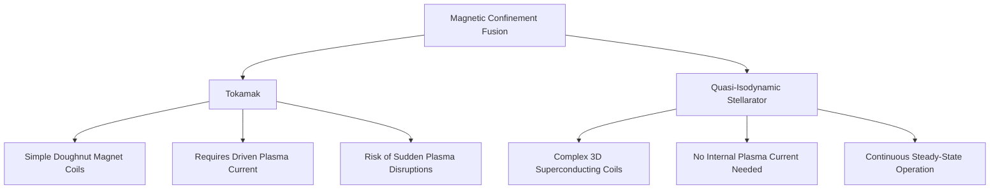
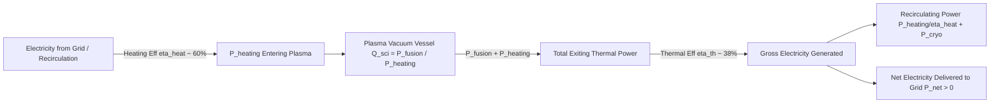
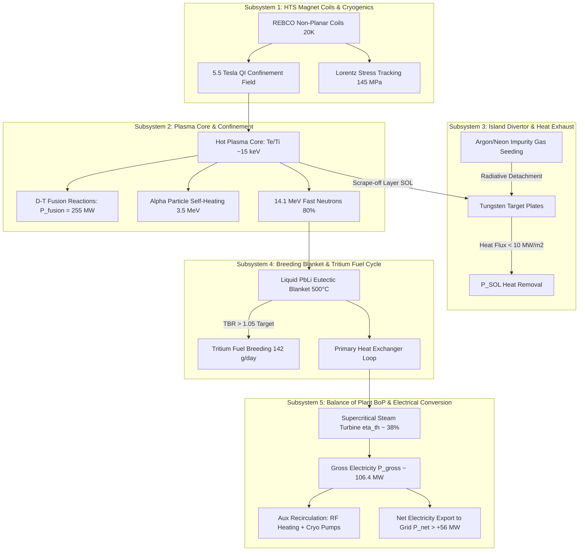
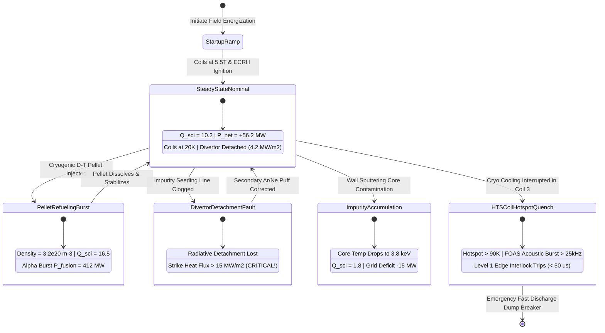
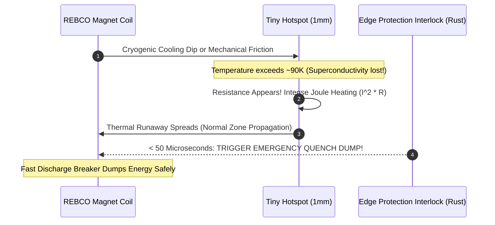
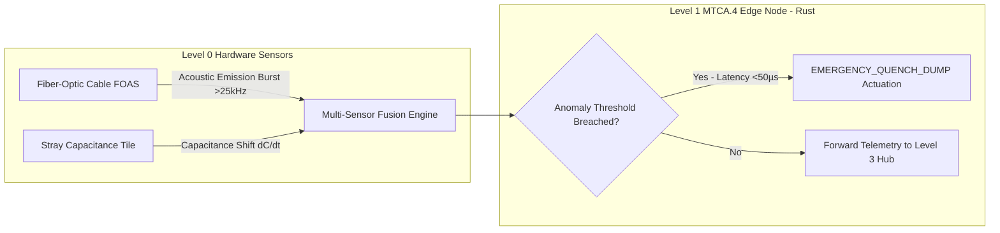
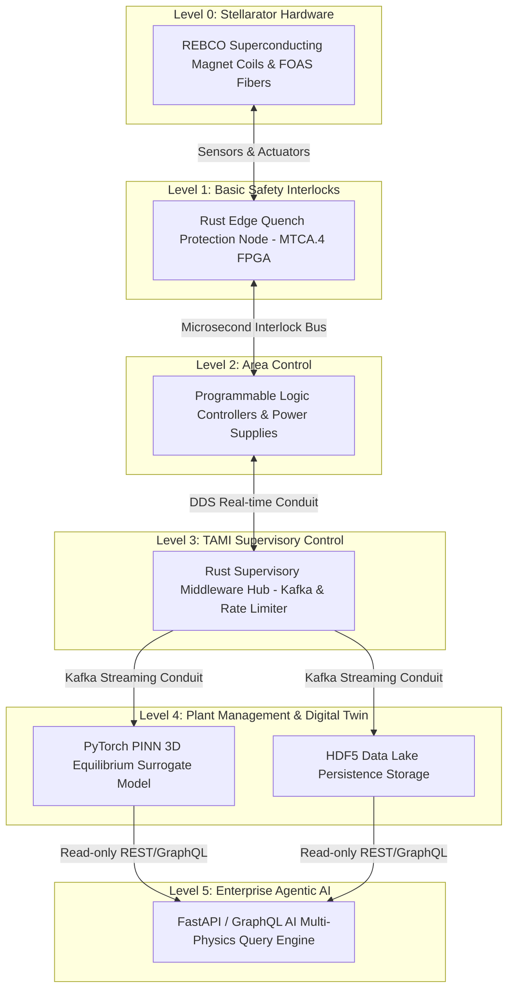
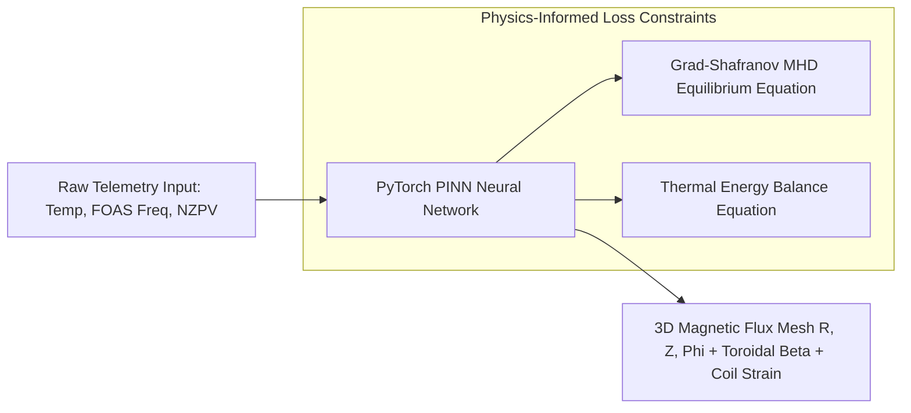
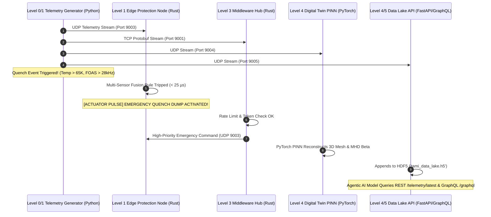

# Beginner's Guide: Nuclear Fusion, Superconducting Stellarators, and TAMI Control Architecture

Welcome! If you are new to nuclear fusion, magnetics, or real-time control software, this tutorial is designed for you. You don't need a PhD in plasma physics or years of software engineering experience to understand how this code works.

This guide breaks down every single concept step-by-step, using simple analogies, visual Mermaid diagrams, and real-world references from [Fusion Energy Base](https://www.fusionenergybase.com/articles?tag=physics).

---

## 📚 Table of Contents

1. [What is Nuclear Fusion?](#1-what-is-nuclear-fusion)
2. [Tokamaks vs. Stellarators: Taming 100 Million°C Plasma](#2-tokamaks-vs-stellarators-taming-100-millionc-plasma)
   - 2.5 [Fusion Power Balance & Scientific Gain ($Q_{\text{sci}}$)](#25-fusion-power-balance--scientific-gain-q_sci)
   - 2.6 [The 5 Core Physical Subsystems of a Quasi-Isodynamic Stellarator](#26-the-5-core-physical-subsystems-of-a-quasi-isodynamic-stellarator)
   - 2.7 [Operational Modes & Anomaly States: Multi-Physics Dynamics](#27-operational-modes--anomaly-states-multi-physics-dynamics)
3. [High-Temperature Superconductors (HTS) & REBCO Magnet Coils](#3-high-temperature-superconductors-hts--rebco-magnet-coils)
4. [The Danger: What is a Magnet Quench?](#4-the-danger-what-is-a-magnet-quench)
5. [How We Detect Quenches: FOAS & Stray Capacitance](#5-how-we-detect-quenches-foas--stray-capacitance)
6. [The Software Stack: Purdue 6-Tier Model & IEC 62443 Security](#6-the-software-stack-purdue-6-tier-model--iec-62443-security)
7. [Digital Twins & Physics-Informed Neural Networks (PINN)](#7-digital-twins--physics-informed-neural-networks-pinn)
8. [How the Code Works: Step-by-Step Execution Flow](#8-how-the-code-works-step-by-step-execution-flow)
9. [External References & Citations](#9-external-references--citations)

---

## 1. What is Nuclear Fusion?

At its core, **nuclear fusion** is the power source of the Sun and stars.

As explained on [Fusion Energy Base - What is Fusion Energy?](https://www.fusionenergybase.com/articles/what-is-fusion-energy):
> *"When two light atomic nuclei like Deuterium and Tritium (two isotopes of hydrogen) fuse into a heavier element like Helium and a free neutron, energy is released. The energy comes from converting a small fraction of the mass of the reactants into kinetic energy."*

```
   Deuterium (H-2)  \
                     ===>  [ FUSION REACTION ] ===>  Helium-4 (3.5 MeV) + Free Neutron (14.1 MeV)
   Tritium (H-3)    /
```

### Why is Fusion Hard?
1. Both atomic nuclei carry a positive electric charge. Like charges **repel each other** (Coulomb repulsion).
2. To force them together, we must heat hydrogen gas to over **100 Million °C** (6 times hotter than the core of the Sun!).
3. At these super-hot temperatures, electrons strip away from atoms, creating an electrically charged soup of matter called **Plasma**.

---

## 2. Tokamaks vs. Stellarators: Taming 100 Million°C Plasma

No physical wall can touch a 100 Million °C plasma without melting instantly. Therefore, fusion reactors use magnetic fields to suspend the plasma in mid-air inside a vacuum chamber—a technique called **Magnetic Confinement**.

There are two main doughnut-shaped (toroidal) reactor designs:

| Feature | Tokamak | Quasi-Isodynamic (QI) Stellarator |
| :--- | :--- | :--- |
| **Magnetic Shape** | Symmetric doughnut (torus) | Complex twisted 3D peanut/torus shape |
| **Plasma Current** | Requires strong electric current driven *through* the plasma | **Zero internal plasma current** needed |
| **Stability** | Prone to sudden plasma collapses ("Disruptions") | **Inherently steady-state** & stable |
| **Coil Shape** | Simple round coils | Complex, computer-optimized 3D twisted coils |



Our software codebase is built specifically for **Quasi-Isodynamic (QI) Superconducting Stellarators** engineered by **SKHY**.

---

## 2.5 Fusion Power Balance & Scientific Gain ($Q_{\text{sci}}$)

A critical concept detailed on [Fusion Energy Base - Scientific Gain and Fusion Power Plants](https://www.fusionenergybase.com/articles/fusion-physics-part-1-scientific-gain-and-fusion-power-plants) is the difference between **Scientific Gain ($Q_{\text{sci}}$)** and **Engineering Gain ($Q_{\text{eng}}$)**.



### Key Power Flow Equations:
1. **Scientific Gain**: $Q_{\text{sci}} = \frac{P_{\text{fusion}}}{P_{\text{heating}}}$
2. **Total Exiting Thermal Power**: $P_{\text{exit}} = P_{\text{fusion}} + P_{\text{heating}} = (Q_{\text{sci}} + 1) \cdot P_{\text{heating}}$
3. **Gross Electricity Generated**: $P_{\text{gross\_elec}} = \eta_{\text{thermal}} \cdot P_{\text{exit}}$
4. **Recirculating Power Needed**: $P_{\text{recirc\_heat}} = \frac{P_{\text{heating}}}{\eta_{\text{heating}}} + P_{\text{cryo}}$
5. **Net Electricity to Grid**: $P_{\text{net}} = P_{\text{gross\_elec}} - P_{\text{recirc\_heat}}$
6. **Engineering Gain**: $Q_{\text{eng}} = \frac{P_{\text{gross\_elec}}}{P_{\text{recirc\_heat}}}$

> **Why $Q_{\text{sci}} = 1.0$ is NOT enough for a power plant**:
> At $Q_{\text{sci}} = 1.0$, $P_{\text{fusion}} = P_{\text{heating}}$. However, because converting electricity to heat ($\eta_{\text{heating}} \approx 60\%$) and converting thermal energy to electricity ($\eta_{\text{thermal}} \approx 38\%$) both have energy losses, $Q_{\text{sci}}$ must reach **$\sim 4.0\text{--}8.0$** before the power plant produces even 1 Watt of net grid power!

---

## 2.6 The 5 Core Physical Subsystems of a Quasi-Isodynamic Stellarator

A commercial fusion power plant is an interconnected ecosystem of 5 core engineering subsystems, each modeled with specialized physics in our Digital Twin:



### Breakdown of the 5 Subsystems:

1. **Subsystem 1: HTS Magnet Coils & Cryogenics**:
   - 3D non-planar twisted coils wound with REBCO high-temperature superconductor tape.
   - Operated at **20 Kelvin** using supercritical helium circulation.
   - Carries $>10,000\text{ Amperes}$ with zero electrical resistance, producing a 5.5 Tesla quasi-isodynamic magnetic bottle.
   - Monitors Critical Current Ratio $I/I_c(B, T)$ and Lorentz stress ($\sigma \approx 145\text{ MPa}$).

2. **Subsystem 2: Plasma Core & Confinement**:
   - The central reaction chamber heated to **150 Million °C** ($T_e, T_i \approx 15\text{ keV}$).
   - Density $n_e \approx 1.85 \times 10^{20}\text{ m}^{-3}$ and energy confinement time $\tau_E \approx 1.65\text{ s}$.
   - Evaluates the **Lawson Triple Product** ($n \cdot T \cdot \tau_E \approx 43.3\text{ keV}\cdot\text{s}\cdot\text{m}^{-3}$) to measure proximity to ignition.
   - Quasi-Isodynamic optimization guarantees closed particle drift orbits and prevents neo-classical losses ($\epsilon_{\text{eff}} < 10^{-4}$).

3. **Subsystem 3: Island Divertor & First-Wall Heat Exhaust**:
   - The "exhaust pipe" of the stellarator. Hot particles diffusing out of the core enter the Scrape-Off Layer (SOL) and strike tungsten divertor plates.
   - Engineering limit: **$\le 10\text{ MW/m}^2$** (any higher and the tungsten plates melt!).
   - **Radiative Detachment**: We inject controlled micro-puffs of Argon/Neon impurity gases. The impurities radiate heat away via light before the particles hit the plates, keeping heat flux at a safe $\sim 4.2\text{ MW/m}^2$.

4. **Subsystem 4: Liquid PbLi Breeding Blanket & Fuel Cycle**:
   - Fusion produces fast neutrons ($14.1\text{ MeV}$) which carry 80% of fusion power.
   - Surrounding the vessel is a **Liquid Lead-Lithium (PbLi)** blanket. Neutrons collide with Lithium-6 atoms:
     $$\text{n} + {}^{6}\text{Li} \to {}^{4}\text{He} + {}^{3}\text{H} (\text{Tritium}) + 4.8\text{ MeV}$$
   - **Tritium Breeding Ratio (TBR)**: Must be $> 1.05$ (our design achieves $\text{TBR} \approx 1.15$), generating **142 grams of Tritium fuel per day**, making the plant 100% self-sufficient!

5. **Subsystem 5: Balance of Plant (BoP) & Electrical Power Conversion**:
   - Converts the blanket thermal energy (500°C) into high-pressure steam driving a turbine generator ($\eta_{\text{thermal}} \approx 38\%$).
   - Subtracts the recirculating power needed to drive auxiliary RF plasma heating and cryogenic helium chillers.
   - Delivers surplus **Net Electricity ($P_{\text{net}} \approx +56.2\text{ MW}$)** to the municipal power grid!

---

## 2.7 Operational Modes & Anomaly States: Multi-Physics Dynamics

Our synthetic data generator and digital twin simulate both normal operation and realistic engineering anomaly modes:



---

## 3. High-Temperature Superconductors (HTS) & REBCO Magnet Coils

To create powerful 10-20 Tesla magnetic fields without consuming gigawatts of electricity, stellarators use **Superconducting Magnets**.

- Standard copper wire has electrical resistance. It gets hot and wastes immense power.
- **Superconductors** carry electric current with **ZERO electrical resistance** when cooled below a critical cryogenic temperature (around -200°C or 70 Kelvin).

We use **REBCO (Rare-Earth Barium Copper Oxide)** high-temperature superconductor tape. REBCO can carry thousands of amperes of electric current through a ribbon as thin as a human hair!

---

## 4. The Danger: What is a Magnet Quench?

A **Quench** is the single most dangerous failure mode in a superconducting magnet system.



If a tiny 1-millimeter spot on a REBCO tape warms up above its critical temperature ($T_c \approx 90\text{ K}$):
1. That spot loses its superconductivity and suddenly develops electrical resistance.
2. The massive electric current ($>10,000\text{ Amperes}$) forcing its way through that small resistive spot creates intense heat ($I^2 R$).
3. This creates a **Thermal Runaway** that rapidly vaporizes the magnet coil if not stopped within **milliseconds**.

The speed at which the non-superconducting zone spreads is called **Normal Zone Propagation Velocity (NZPV)**. In REBCO tape, NZPV is notoriously slow ($1\text{--}10\text{ cm/s}$), which means heat concentrates in one spot instead of spreading evenly, making it easy to burn out the magnet unless an ultra-fast edge system acts immediately!

---

## 5. How We Detect Quenches: FOAS & Stray Capacitance

Because a quench starts in microseconds, we use two advanced complementary sensor technologies:



1. **Fiber-Optic Acoustic Sensing (FOAS)**: Fiber-optic cables are wound directly alongside the superconductor. When REBCO tape undergoes microscopic stress relaxation prior to a quench, it emits high-frequency sound waves ($>25\text{ kHz}$). The fiber detects this acoustic strain instantly!
2. **Stray Capacitance Probes**: Metallic sensor tiles measure localized changes in dielectric capacitance ($dC/dt$) caused by thermal breakdown of cryogenic insulation.

---

## 6. The Software Stack: Purdue 6-Tier Model & IEC 62443 Security

Industrial power plants use the **Purdue Enterprise Reference Architecture (Purdue Model)** to organize control systems into isolated security layers (IEC 62443 Zones and Conduits):



### The 6 Purdue Levels Explained Simply:
- **Level 0 (Physical Hardware)**: The physical magnets, cryogenic helium coolers, and fiber-optic sensors.
- **Level 1 (Edge Protection)**: Ultra-fast Rust microsecond kernel running on FPGA hardware (`edge_quench`). Evaluates sensor rules and trips fast discharge breakers in **$<50\text{ microseconds}$**.
- **Level 2 (Area Control)**: Power supply and vacuum controllers.
- **Level 3 (Supervisory Middleware)**: TAMI Rust hub (`middleware_hub`). Ingests Protobuf data, checks Zero-Trust security tokens, rate-limits incoming signals, and bridges telemetry to Kafka.
- **Level 4 (Plant Data Lake & Digital Twin)**: PyTorch PINN model (`digital_twin_engine.py`) calculating 3D magnetic flux surfaces, and HDF5 storage archiving time-series data.
- **Level 5 (Enterprise Agentic AI)**: FastAPI and Strawberry GraphQL API (`ai_ingestion_api.py`) allowing AI models to query historical diagnostics for training.

---

## 7. Digital Twins & Physics-Informed Neural Networks (PINN)

A **Digital Twin** is a virtual, real-time 3D simulation of the physical stellarator running alongside the physical machine.

To compute complex 3D magnetic equilibrium equations (V3FIT physics code) in real-time, we use a **Physics-Informed Neural Network (PINN)**:



Unlike black-box AI models, a **PINN** has laws of physics (magnetohydrodynamics and energy conservation) baked directly into its neural loss function. This ensures its 3D predictions obey real physical laws!

---

## 8. How the Code Works: Step-by-Step Execution Flow

When you run `python run_demo.py`, here is what happens under the hood:



---

## 9. External References & Citations

All concepts and physics principles in this tutorial are drawn from peer-reviewed fusion research and educational resources. For further reading, explore these official articles on [Fusion Energy Base](https://www.fusionenergybase.com):

1. **Fusion Energy Basics & D-T Reaction Physics**:
   - Reference: [Fusion Energy Base - What is Fusion Energy?](https://www.fusionenergybase.com/articles/what-is-fusion-energy)
2. **Lawson Criterion & Triple Product Progress**:
   - Reference: [Fusion Energy Base - Continuing Progress Toward Fusion Energy Breakeven](https://www.fusionenergybase.com/articles/continuing-progress-toward-fusion-energy-breakeven-and-gain-as-measured-against-the-lawson-criteria)
3. **High-Temperature Superconductors (HTS) in Commercial Fusion**:
   - Reference: [Fusion Energy Base - HTS Tape Applications in Magnet Design](https://www.fusionenergybase.com/articles/cfs-places-largest-ever-hts-tape-order-with-fujikura-for-arc-power-plant)
4. **Fusion Energy Physics Tagged Repository**:
   - Reference: [Fusion Energy Base - Physics Tagged Articles](https://www.fusionenergybase.com/articles?tag=physics)
